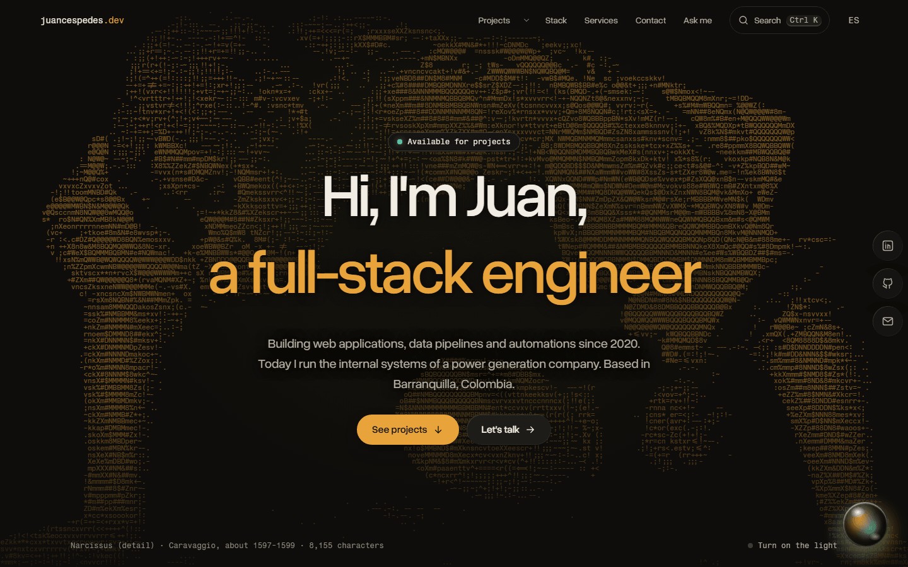
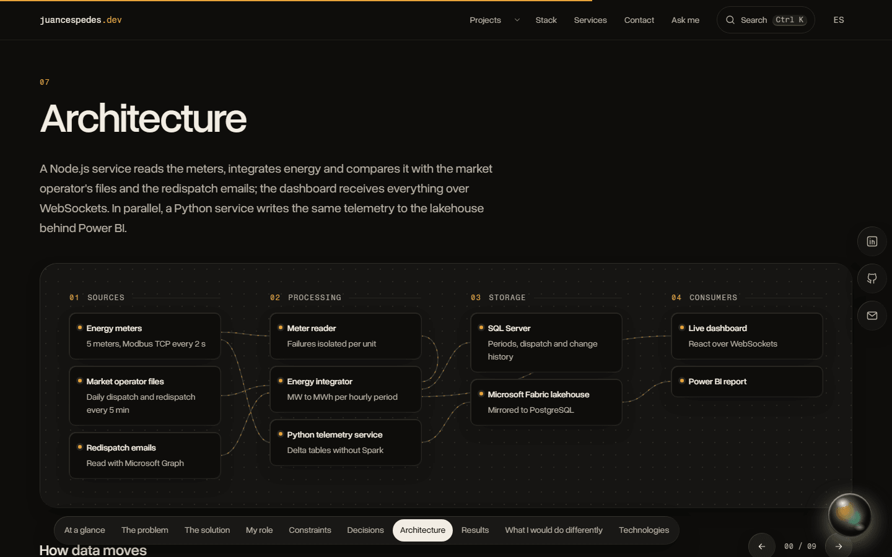
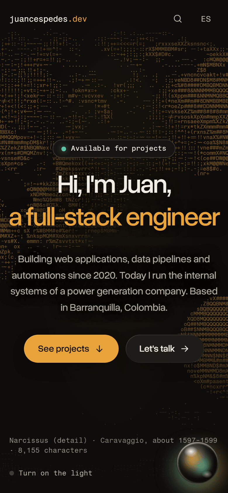
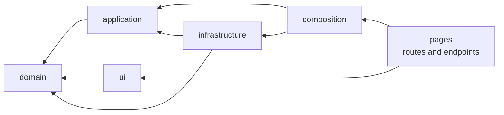

# juancespedes.dev

[](https://github.com/juanpacj-wq/juancespedes.dev/actions/workflows/ci.yml)
[](https://github.com/juanpacj-wq/juancespedes.dev/actions/workflows/codeql.yml)
[](https://github.com/juanpacj-wq/juancespedes.dev/actions/workflows/deploy.yml)
[](https://github.com/juanpacj-wq/juancespedes.dev/actions/workflows/uptime.yml)
[](https://securityheaders.com/?q=juancespedes.dev&followRedirects=on)
[-blue.svg>)](LICENSE)

**Live: [juancespedes.dev](https://juancespedes.dev)** ·
health check: [`/api/health`](https://juancespedes.dev/api/health) (reports the deployed commit)

Portfolio of **Juan Céspedes**, systems engineer in Barranquilla, Colombia: full-stack development,
data and automation. Built in public: the repository is part of the portfolio, so the architecture,
decisions and quality checks are meant to be read.

> Status: **live**. Every phase of the roadmap below is done; later decisions are in the ADRs.
> Live design reference: [/design-system](https://juancespedes.dev/design-system)
> ([docs](docs/design-system.md)).



| Case study: architecture drawn from data                                 | Phone                                                |
| ------------------------------------------------------------------------ | ---------------------------------------------------- |
|  |  |

## Operations

- **Security headers** on every response, with a content security policy that allows only the
  hashed inline scripts the build emitted ([ADR 0013](docs/adr/0013-launch-hardening-and-operations.md)).
- **Uptime**: checked every 15 minutes from GitHub Actions; an outage opens an issue.
- **Errors**: browser errors are reported, without visitor data, to Workers Logs.
- **Analytics**: Cloudflare Web Analytics, cookieless.
- **Releases**: release-please, with the same required checks as any pull request.
- **"Ask me"**: a chat that answers about the published work (DeepSeek by default, Claude optional), with prompt caching,
  Turnstile, daily quotas, a kill switch and a 30-question evaluation set
  ([ADR 0017](docs/adr/0017-ask-me-chat.md), [runbook](docs/runbooks/ask-me-chat.md)).
- **Command palette**: Ctrl+K (or the Search button) jumps to any page, project or note and runs
  a few actions ([ADR 0016](docs/adr/0016-command-palette.md)).
- **Writing**: [technical notes](https://juancespedes.dev/notas) and a [now page](https://juancespedes.dev/ahora), both bilingual content validated like the projects ([ADR 0015](docs/adr/0015-notes-and-now-page.md)).
- Runbooks: [deploy and rollback](docs/runbooks/deploy.md), [contact form](docs/runbooks/contact-form.md),
  [monitoring and incidents](docs/runbooks/monitoring.md).

## Architecture at a glance



- **domain**: pure TypeScript entities and rules. No framework imports (enforced).
- **application**: use cases and the ports they need.
- **infrastructure**: adapters for content collections, email, AI and rate limiting.
- **ui**: Astro and React components that render view models.
- **composition**: the single place where use cases are wired to adapters.
- **pages**: thin Astro routes and API endpoints.

Imports may only point inward. Two independent tools check it on every pull request
(`eslint-plugin-boundaries` and `dependency-cruiser`). Details in [docs/architecture.md](docs/architecture.md).

## Decisions

| ADR                                                                | Decision                                                                  |
| ------------------------------------------------------------------ | ------------------------------------------------------------------------- |
| [0001](docs/adr/0001-layered-architecture.md)                      | Layered architecture in a mostly static site, and where it stops          |
| [0002](docs/adr/0002-astro-with-react-islands.md)                  | Astro with React islands                                                  |
| [0003](docs/adr/0003-cloudflare-workers-hosting.md)                | Cloudflare Workers with static assets                                     |
| [0004](docs/adr/0004-projects-as-typed-content.md)                 | Projects as typed content, extensible by kind                             |
| [0005](docs/adr/0005-i18n-by-route.md)                             | Spanish and English by route                                              |
| [0006](docs/adr/0006-tailwind-on-design-tokens.md)                 | Tailwind CSS v4 on design tokens                                          |
| [0007](docs/adr/0007-testing-strategy.md)                          | Testing strategy and quality gates                                        |
| [0008](docs/adr/0008-content-validation-layers.md)                 | Content validated in three layers: schema, domain rules, cross-file tests |
| [0009](docs/adr/0009-theming-and-design-tokens.md)                 | Design tokens; raw colors rejected in CI (one theme since 0032)           |
| [0010](docs/adr/0010-contact-form-delivery.md)                     | Contact form on Email Routing and Turnstile; fails closed; stores nothing |
| [0011](docs/adr/0011-case-study-pages.md)                          | Case study pages: fixed template, diagrams as data, private denylist      |
| [0012](docs/adr/0012-bilingual-routes-and-seo.md)                  | Spanish at the root, English under /en; hreflang, sitemap, JSON-LD, OG    |
| [0013](docs/adr/0013-launch-hardening-and-operations.md)           | Security headers, monitoring without third parties, gated releases        |
| [0014](docs/adr/0014-mutation-testing.md)                          | Mutation testing of the domain with Stryker, weekly                       |
| [0015](docs/adr/0015-notes-and-now-page.md)                        | Technical notes and a "now" page as validated, bilingual content          |
| [0016](docs/adr/0016-command-palette.md)                           | Ctrl+K command palette with a native dialog, no UI framework              |
| [0017](docs/adr/0017-ask-me-chat.md)                               | "Ask me" chat with a cached corpus, quotas and an evaluation set          |
| [0018](docs/adr/0018-chiaroscuro-redesign.md)                      | Chiaroscuro identity: ASCII painting hero, visible prices                 |
| [0019](docs/adr/0019-reference-hero-chat-and-case-cards.md)        | Rotating role in the hero, floating chat, case-study cards                |
| [0020](docs/adr/0020-not-found-reflection.md)                      | The 404 as an ASCII "404" mirrored under a waterline                      |
| [0021](docs/adr/0021-case-study-redesign.md)                       | Case studies as a told story: plain problem, motion layer, live diagram   |
| [0022](docs/adr/0022-real-screenshots-and-gallery.md)              | Real screenshots in case studies, and a gallery in context                |
| [0023](docs/adr/0023-technology-logo-band.md)                      | Technologies as one draggable band of logos                               |
| [0024](docs/adr/0024-faster-deploys.md)                            | Faster deploys: measure what visitors get, catch budget breaks locally    |
| [0025](docs/adr/0025-business-impact-section.md)                   | Business impact instead of a CV-style history                             |
| [0026](docs/adr/0026-stack-by-area.md)                             | Capabilities as a stack of logos by area                                  |
| [0027](docs/adr/0027-sharp-screenshots-and-responsive-captures.md) | Sharp screenshots, with phones and a tablet beside the desktop            |
| [0028](docs/adr/0028-pinned-project-stage.md)                      | Featured projects on a pinned stage                                       |
| [0029](docs/adr/0029-wide-clean-layout.md)                         | A wide, quieter layout with one grotesk                                   |
| [0030](docs/adr/0030-overused-grotesk.md)                          | Overused Grotesk, chosen from what 2026 sites use                         |
| [0031](docs/adr/0031-fragment-mono.md)                             | Fragment Mono replaces Geist Mono                                         |
| [0032](docs/adr/0032-dark-only.md)                                 | One theme: dark                                                           |
| [0033](docs/adr/0033-work-by-area.md)                              | Projects by area of work                                                  |
| [0034](docs/adr/0034-engine-and-instance.md)                       | The site as the first instance of a reusable engine                       |

## Quality gates

Every pull request must pass all of them ([ADR 0007](docs/adr/0007-testing-strategy.md)):

| Gate          | Tool                                                                               | Threshold                                                |
| ------------- | ---------------------------------------------------------------------------------- | -------------------------------------------------------- |
| Format        | Prettier                                                                           | No diff                                                  |
| Lint          | ESLint, strict type-checked rules, a11y rules                                      | 0 errors, 0 warnings                                     |
| Types         | `astro check`, `tsc` (strictest config)                                            | 0 errors                                                 |
| Architecture  | eslint-plugin-boundaries, dependency-cruiser                                       | 0 violations                                             |
| Unit tests    | Vitest                                                                             | ≥ 90 % coverage of domain and application                |
| Content       | Vitest over the real content files                                                 | ES/EN parity, sourced metrics, no internal data          |
| Design tokens | Token check script, contrast test over the stylesheet                              | No raw colors; every text pair AA                        |
| End-to-end    | Playwright on Chromium, WebKit and mobile, against the production build on workerd | All pass                                                 |
| Accessibility | axe-core                                                                           | 0 WCAG 2.2 AA violations                                 |
| Performance   | Lighthouse CI                                                                      | ≥ 95 performance, best practices, SEO; 100 accessibility |
| JavaScript    | Bundle budget script (gzip)                                                        | ≤ 82 kB total, ≤ 10 kB per chunk besides the runtime     |
| Page weight   | Page budget script (compressed HTML)                                               | Per-page limits; no extra blocking CSS or eager images   |
| Security      | pnpm audit, gitleaks, CodeQL, Dependabot                                           | No high-severity findings                                |

Weekly, and on demand: **mutation testing** of the domain with Stryker, break below 80 %
([ADR 0014](docs/adr/0014-mutation-testing.md)).

## Run it locally

Requirements: Node 24+ and pnpm 10.

```bash
pnpm install          # also activates the git hooks in .githooks/
pnpm dev              # http://localhost:4321
pnpm verify           # format, lint, types, architecture, unit coverage, build, JS and page budgets
pnpm exec playwright install chromium webkit
pnpm test:e2e         # end-to-end and accessibility on the production build
pnpm lighthouse:local # Lighthouse as CI runs it, in Docker, after pnpm build
pnpm test:mutation    # mutation testing of the domain (about ten minutes)
pnpm eval:chat        # chat evaluation set against the real model (needs DEEPSEEK_API_KEY or ANTHROPIC_API_KEY, costs money)
```

Environment variables are documented in [.env.example](.env.example) and validated at startup.

## Adding a project

Projects are content, not code: one folder per project with a Spanish and an English file.

```bash
pnpm new:project report generation-kpis "Indicadores de generación" "Generation KPIs"
```

The project starts as a draft (visible only in `pnpm dev`). The build and the content tests check
its shape, its business rules, its translation and the anonymization policy. Full guide:
[docs/adding-a-project.md](docs/adding-a-project.md).

## Project structure

```
content/
  profile/            experience, services and prices, one file per language
  projects/<slug>/    one folder per project: es.mdx and en.mdx
  notes/<slug>/       technical notes, es.mdx and en.mdx
  now/                the "now" page
  achievements.yaml   business impact, with charts
  technologies.yaml   technology catalog, mapped to capabilities
src/
  assets/projects/    project screenshots and their captions
  domain/          entities and rules, framework-free
  application/     use cases and ports
  infrastructure/  adapters (content, email, AI, rate limiting)
  composition/     composition root
  ui/              components, layouts, design tokens
  pages/           routes and /api endpoints
tests/
  unit/            domain, application, adapters and scripts
  content/         cross-file rules over the real content
  e2e/             Playwright and axe
docs/
  adr/             architecture decision records
  runbooks/        deploy and rollback
```

## Roadmap

| Phase | Scope                                                            | State |
| ----- | ---------------------------------------------------------------- | ----- |
| F0    | Foundations: tooling, CI, ADRs, health endpoint, deploy pipeline | Done  |
| F1    | Domain model and typed project content                           | Done  |
| F2    | Design system and layout                                         | Done  |
| F3    | Home page sections and contact form                              | Done  |
| F4    | Case studies                                                     | Done  |
| F5    | English version and SEO                                          | Done  |
| F6    | Launch v1.0 on juancespedes.dev                                  | Done  |
| F7    | Command palette, "Ask me" chat, notes                            | Done  |

## Workflow

Trunk-based development: `main` is protected, every change goes through a pull request with all
checks green and is squash-merged. Commit messages and PR titles follow
[Conventional Commits](https://www.conventionalcommits.org/); release-please maintains the
changelog and versions.

## License

Source code: [MIT](LICENSE). Written content, photographs, case studies and diagrams are
© Juan Pablo Céspedes, all rights reserved; fonts, the painting and logos keep their own terms
([CONTENT-LICENSE.md](CONTENT-LICENSE.md)).
