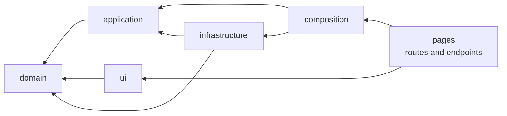

# juancespedes.dev

[](https://github.com/juanpacj-wq/juancespedes.dev/actions/workflows/ci.yml)
[](https://github.com/juanpacj-wq/juancespedes.dev/actions/workflows/codeql.yml)
[](https://github.com/juanpacj-wq/juancespedes.dev/actions/workflows/deploy.yml)
[-blue.svg>)](LICENSE)

**Live: [juancespedes.dev](https://juancespedes.dev)** ·
health check: [`/api/health`](https://juancespedes.dev/api/health) (reports the deployed commit)

Portfolio of **Juan Céspedes**, systems engineer in Barranquilla, Colombia: full-stack development,
data and automation. Built in public: the repository is part of the portfolio, so the architecture,
decisions and quality checks are meant to be read.

> Status: **phase F3 (home page and contact form) done, deployed**. Case study pages arrive in F4.
> Live design reference: [/design-system](https://juancespedes.dev/design-system)
> ([docs](docs/design-system.md)).

## Architecture at a glance



- **domain**: pure TypeScript entities and rules. No framework imports (enforced).
- **application**: use cases and the ports they need.
- **infrastructure**: adapters for content collections, email, AI and rate limiting.
- **ui**: Astro and React components that render view models.
- **composition**: the single place where use cases are wired to adapters.
- **pages**: thin Astro routes and API endpoints.

Imports may only point inward. Two independent tools check it on every pull request
(`eslint-plugin-boundaries` and `dependency-cruiser`). Details in [docs/architecture.md](docs/architecture.md).

## Decisions

| ADR                                                 | Decision                                                                  |
| --------------------------------------------------- | ------------------------------------------------------------------------- |
| [0001](docs/adr/0001-layered-architecture.md)       | Layered architecture in a mostly static site, and where it stops          |
| [0002](docs/adr/0002-astro-with-react-islands.md)   | Astro with React islands                                                  |
| [0003](docs/adr/0003-cloudflare-workers-hosting.md) | Cloudflare Workers with static assets                                     |
| [0004](docs/adr/0004-projects-as-typed-content.md)  | Projects as typed content, extensible by kind                             |
| [0005](docs/adr/0005-i18n-by-route.md)              | Spanish and English by route                                              |
| [0006](docs/adr/0006-tailwind-on-design-tokens.md)  | Tailwind CSS v4 on design tokens                                          |
| [0007](docs/adr/0007-testing-strategy.md)           | Testing strategy and quality gates                                        |
| [0008](docs/adr/0008-content-validation-layers.md)  | Content validated in three layers: schema, domain rules, cross-file tests |
| [0009](docs/adr/0009-theming-and-design-tokens.md)  | Theming with light-dark() tokens; raw colors rejected in CI               |
| [0010](docs/adr/0010-contact-form-delivery.md)      | Contact form on Email Routing and Turnstile; fails closed; stores nothing |

## Quality gates

Every pull request must pass all of them ([ADR 0007](docs/adr/0007-testing-strategy.md)):

| Gate          | Tool                                                                               | Threshold                                                |
| ------------- | ---------------------------------------------------------------------------------- | -------------------------------------------------------- |
| Format        | Prettier                                                                           | No diff                                                  |
| Lint          | ESLint, strict type-checked rules, a11y rules                                      | 0 errors, 0 warnings                                     |
| Types         | `astro check`, `tsc` (strictest config)                                            | 0 errors                                                 |
| Architecture  | eslint-plugin-boundaries, dependency-cruiser                                       | 0 violations                                             |
| Unit tests    | Vitest                                                                             | ≥ 90 % coverage of domain and application                |
| Content       | Vitest over the real content files                                                 | ES/EN parity, sourced metrics, no internal data          |
| Design tokens | Token check script, contrast test over the stylesheet                              | No raw colors; every text pair AA in both themes         |
| End-to-end    | Playwright on Chromium, WebKit and mobile, against the production build on workerd | All pass                                                 |
| Accessibility | axe-core                                                                           | 0 WCAG 2.2 AA violations                                 |
| Performance   | Lighthouse CI                                                                      | ≥ 95 performance, best practices, SEO; 100 accessibility |
| JavaScript    | Bundle budget script (gzip)                                                        | ≤ 75 kB total; islands hydrate on visibility             |
| Security      | pnpm audit, gitleaks, CodeQL, Dependabot                                           | No high-severity findings                                |

## Run it locally

Requirements: Node 24+ and pnpm 10.

```bash
pnpm install          # also activates the git hooks in .githooks/
pnpm dev              # http://localhost:4321
pnpm verify           # format, lint, types, architecture, unit coverage, build
pnpm exec playwright install chromium webkit
pnpm test:e2e         # end-to-end and accessibility on the production build
```

Environment variables are documented in [.env.example](.env.example) and validated at startup.

## Adding a project

Projects are content, not code: one folder per project with a Spanish and an English file.

```bash
pnpm new:project report generation-kpis "Indicadores de generación" "Generation KPIs"
```

The project starts as a draft (visible only in `pnpm dev`). The build and the content tests check
its shape, its business rules, its translation and the anonymization policy. Full guide:
[docs/adding-a-project.md](docs/adding-a-project.md).

## Project structure

```
content/
  projects/<slug>/ one folder per project: es.mdx, en.mdx and images
  technologies.yaml   technology catalog, mapped to capabilities
  headline-metrics.yaml   home page figures, each with its source
src/
  domain/          entities and rules, framework-free
  application/     use cases and ports
  infrastructure/  adapters (content, email, AI, rate limiting)
  composition/     composition root
  ui/              components, layouts, design tokens
  pages/           routes and /api endpoints
tests/
  unit/            domain, application, adapters and scripts
  content/         cross-file rules over the real content
  e2e/             Playwright and axe
docs/
  adr/             architecture decision records
  runbooks/        deploy and rollback
```

## Roadmap

| Phase | Scope                                                            | State   |
| ----- | ---------------------------------------------------------------- | ------- |
| F0    | Foundations: tooling, CI, ADRs, health endpoint, deploy pipeline | Done    |
| F1    | Domain model and typed project content                           | Done    |
| F2    | Design system and layout                                         | Done    |
| F3    | Home page sections and contact form                              | Done    |
| F4    | Case studies                                                     | Next    |
| F5    | English version and SEO                                          | Planned |
| F6    | Launch v1.0 on juancespedes.dev                                  | Planned |
| F7    | Command palette, "Ask me" chat, notes                            | Planned |

## Workflow

Trunk-based development: `main` is protected, every change goes through a pull request with all
checks green and is squash-merged. Commit messages and PR titles follow
[Conventional Commits](https://www.conventionalcommits.org/); release-please maintains the
changelog and versions.

## License

Source code: [MIT](LICENSE). Written content, photographs, case studies and diagrams:
© Juan Pablo Céspedes, all rights reserved.
