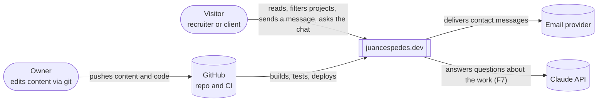
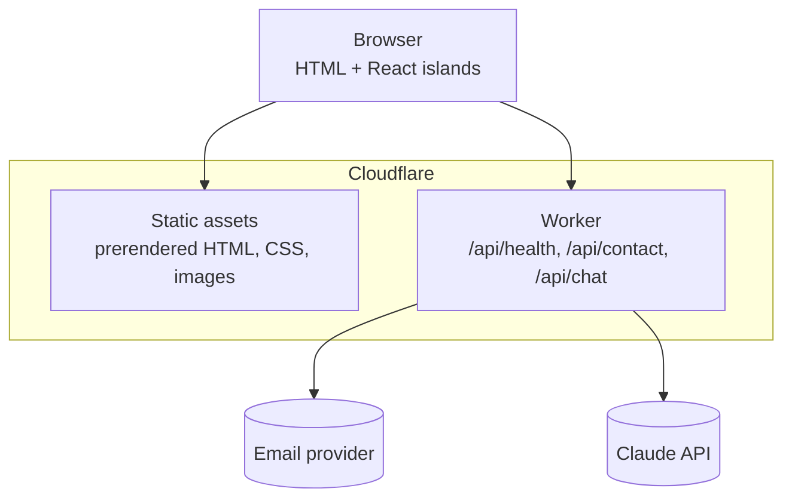
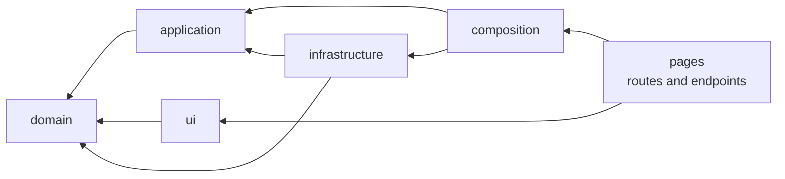

# Architecture

## System context (C4 level 1)

## Containers (C4 level 2)

## Layers inside the code

Arrows point in the direction of allowed imports. The rule is explained in
[ADR 0001](adr/0001-layered-architecture.md) and enforced by ESLint and dependency-cruiser.
The current module graph is generated with `pnpm arch:graph` into
[`dependency-graph.mmd`](dependency-graph.mmd).

## Request flow example: `GET /api/health`

1. `src/pages/api/health.ts` (pages) asks the container for `getHealthStatus`.
2. `src/composition/container.ts` built it with the `systemClock` adapter and the validated
   `APP_VERSION` from `astro:env`.
3. `src/application/use-cases/get-health-status.ts` produces the report using only the `Clock`
   port, so its test uses a fixed clock.
